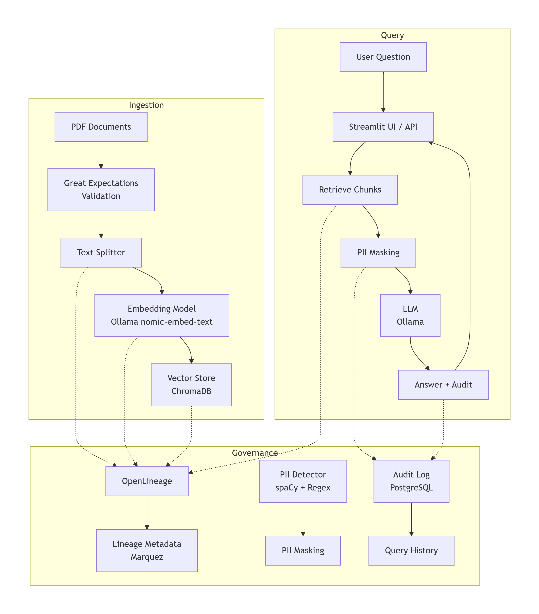
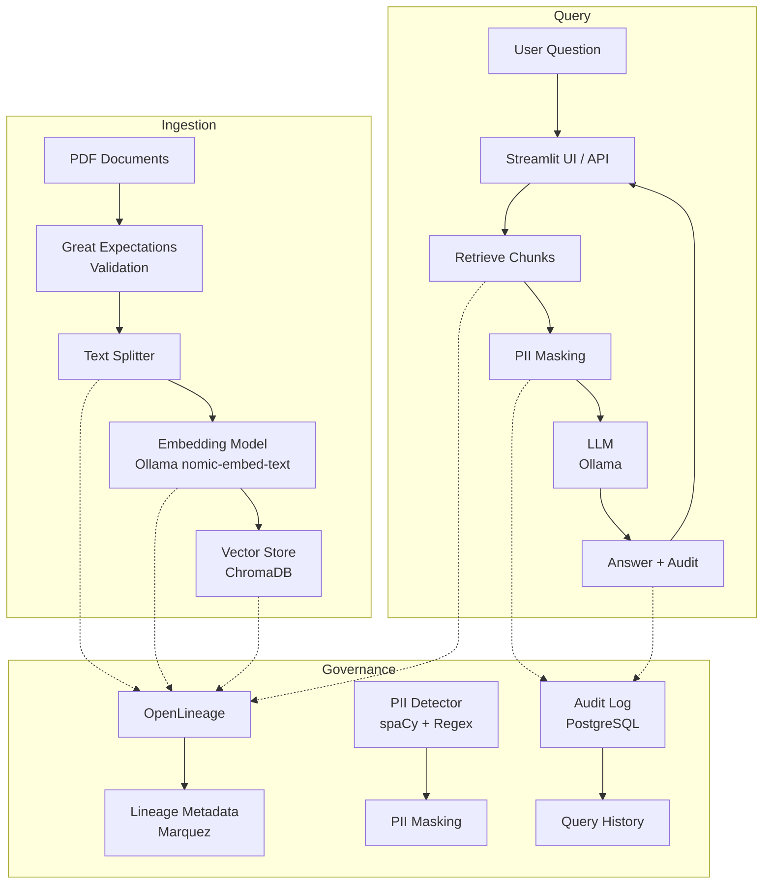

# Governed RAG Pipeline

A Retrieval-Augmented Generation (RAG) system with built-in data governance: data lineage, PII detection and masking, data validation, and audit logging. This project demonstrates how to build AI systems that comply with regulations like GDPR and SOC2.

---

## Table of Contents
- [Overview](#overview)
- [Features](#features)
- [Architecture](#architecture)
- [Tech Stack](#tech-stack)
- [Prerequisites](#prerequisites)
- [Setup & Installation](#setup--installation)
- [Running the Pipeline](#running-the-pipeline)
- [Governance Features](#governance-features)
- [Using the Service](#using-the-service)
- [Evaluation & Testing](#evaluation--testing)
- [Troubleshooting](#troubleshooting)
- [Next Steps](#next-steps)

---

## Overview

This project extends a standard RAG system with **governance controls** to meet enterprise compliance requirements. It tracks the entire data lifecycle, ensures sensitive information is redacted before reaching the LLM, validates incoming data quality, and maintains an immutable audit log of all queries.

Key governance aspects:
- **Data Lineage**: Track each document → chunk → embedding → query path using OpenLineage (Marquez).
- **PII Masking**: Automatically detect and redact personal information (names, emails, SSNs, etc.) from retrieved contexts.
- **Data Validation**: Use Great Expectations to validate PDFs before ingestion (e.g., ensure non‑empty content).
- **Audit Logging**: Record every user query, the masked context, and the answer in a PostgreSQL database.

---

## Features

- **Ingestion**:
  - Load PDFs from a local folder.
  - Validate each document with Great Expectations.
  - Chunk documents and generate embeddings with Ollama (`nomic-embed-text`).
  - Store vectors in ChromaDB.
  - Emit OpenLineage events for each step.

- **Query**:
  - Retrieve relevant chunks using semantic search.
  - Automatically detect and redact PII from contexts.
  - Generate an answer using Ollama LLM (`llama3.2`).
  - Log the query, masked context, and answer in PostgreSQL.
  - Return the audit ID to the user.

- **Governance**:
  - View lineage in Marquez UI.
  - Inspect audit logs in PostgreSQL.
  - PII masking ensures no sensitive data reaches the LLM.

---

## Architecture





*To generate a PNG image of this diagram, copy the Mermaid code into [mermaid.live](https://mermaid.live) and export as PNG.*

---

## Tech Stack

| Component               | Technology                          |
|-------------------------|-------------------------------------|
| **RAG Framework**       | LangChain                           |
| **Vector Store**        | ChromaDB                            |
| **Embedding & LLM**     | Ollama (`nomic-embed-text`, `llama3.2`) |
| **Data Validation**     | Great Expectations                  |
| **Data Lineage**        | OpenLineage + Marquez               |
| **PII Detection**       | spaCy + regex                       |
| **Audit Logging**       | PostgreSQL                          |
| **API**                 | FastAPI                             |
| **UI**                  | Streamlit                           |
| **Containerization**    | Docker Compose                      |

---

## Prerequisites

- **Python 3.10 or higher**
- **Docker and Docker Compose** (for PostgreSQL and Marquez)
- **Ollama** installed and running locally ([ollama.com](https://ollama.com))
- **Git** (optional, for cloning)

---

## Setup & Installation

### 1. Clone the Repository
```bash
git clone https://github.com/your-username/governed-rag-pipeline.git
cd governed-rag-pipeline
```

### 2. Create Virtual Environment
```bash
python -m venv venv
source venv/bin/activate  # On Windows: venv\Scripts\activate
```

### 3. Install Python Dependencies
```bash
pip install -r requirements.txt
python -m spacy download en_core_web_sm   # for PII detection
```

### 4. Start Infrastructure (PostgreSQL & Marquez)
```bash
docker-compose up -d
```
This starts:
- **PostgreSQL** on port 5432 (for audit logs)
- **Marquez** on port 5000 (OpenLineage server)

Wait a few seconds for both containers to be ready.

### 5. Configure Environment Variables
Copy `.env.example` to `.env`:
```bash
cp .env.example .env
```
Edit if necessary (defaults should work for local setup).

### 6. Initialize Audit Database
```bash
python scripts/init_db.py
```
This creates the `audit_logs` table in PostgreSQL.

### 7. Pull Ollama Models
```bash
ollama pull nomic-embed-text
ollama pull llama3.2
```
Ensure Ollama is running (by default on `http://localhost:11434`).

### 8. Prepare Documents
Place your PDF files in the `data/` folder. You can download sample 10-K filings from the [SEC EDGAR](https://www.sec.gov/edgar/searchedgar/companysearch) website.

### 9. Run Ingestion
```bash
python src/ingest.py
```
This will:
- Load PDFs
- Validate them with Great Expectations
- Chunk and embed them
- Store in ChromaDB
- Emit lineage events to Marquez

You should see output confirming validation and successful storage.

---

## Running the Pipeline

You need to run **three processes** (API, UI, and optionally the lineage server).

### Terminal 1: Start the API
```bash
uvicorn src.query:app --reload --port 8000
```
The API will be available at `http://localhost:8000`.

### Terminal 2: Start the Streamlit UI
```bash
streamlit run app.py
```
Open the URL shown (typically `http://localhost:8501`).

### (Optional) View Lineage in Marquez
Open your browser and go to `http://localhost:5000`. You should see the Marquez UI where you can explore data lineage after ingestion and queries.

---

## Governance Features

### 1. Great Expectations Validation
During ingestion, each PDF is validated with two expectations:
- `expect_column_values_to_not_be_null` on text content.
- `expect_column_value_lengths_to_be_between` with min length 10 characters.

If validation fails, the ingestion stops and an error is raised.

### 2. PII Masking
The `pii_detector.py` module uses:
- **spaCy NER** to detect `PERSON`, `EMAIL`, `ORG`, `GPE`, `LOC`.
- **Regex** for emails, SSNs (123-45-6789), and phone numbers.

In the query endpoint, before sending contexts to the LLM, each chunk is scanned and PII is replaced with placeholders like `[REDACTED EMAIL]`. This ensures no sensitive information is exposed.

### 3. OpenLineage Data Lineage
During ingestion:
- Each document load emits a `START` event.
- Chunking and embedding steps also emit events.
- The final storage in ChromaDB emits a `COMPLETE` event with the dataset `chromadb:governed_docs`.

During query:
- The retrieval step is also recorded (if extended). In this MVP, lineage is focused on ingestion, but you can easily add query lineage.

All events are sent to Marquez, where you can visualize the flow.

### 4. Audit Logging
Every query is logged in PostgreSQL with:
- `user_id` (provided in request)
- `question` (original)
- `masked_context` (concatenated masked chunks)
- `answer` (generated by LLM)
- `timestamp`

The API returns the `audit_id` so the user can reference it later.

---

## Using the Service

### API Endpoint

#### `POST /query`
**Request:**
```json
{
  "question": "What is the company's revenue for 2023?",
  "user_id": "demo_user"
}
```
**Response:**
```json
{
  "answer": "The revenue for 2023 was $10.5 billion.",
  "audit_id": 42,
  "contexts": [
    "[REDACTED PERSON] reported revenue of $10.5B...",
    "..."
  ]
}
```

### Streamlit UI

1. Enter a user ID (e.g., `demo_user`).
2. Type a question.
3. Click **Ask**.
4. See the answer and audit ID.
5. Expand to view the masked contexts.

### Inspecting Audit Logs
Connect to PostgreSQL to see the logs:
```bash
psql -h localhost -U postgres -d audit_db
```
Then:
```sql
SELECT * FROM audit_logs ORDER BY timestamp DESC LIMIT 5;
```

### Viewing Lineage
Visit `http://localhost:5000` and explore the Marquez UI. You'll see jobs like `load_document:filename.pdf`, `chunk_documents`, `store_embeddings` and the datasets they produce.

---

## Evaluation & Testing

### Unit Tests
Run tests with pytest:
```bash
pytest tests/
```

### Manual Testing
- **Validation**: Add a corrupted PDF (empty file) to `data/` and run ingestion; it should fail with validation error.
- **PII Masking**: Send a question that triggers a chunk containing an email address; the response context should show `[REDACTED EMAIL]`.
- **Audit Logging**: Query with different user IDs; verify the logs in PostgreSQL.
- **Lineage**: After ingestion, check Marquez UI for the lineage graph.

---

## Troubleshooting

| Problem | Possible Solution |
|---------|-------------------|
| `spacy` model not found | Run `python -m spacy download en_core_web_sm` again. |
| Great Expectations validation fails | Ensure your PDFs contain actual text (not scanned images). |
| Ollama embedding fails | Check Ollama is running: `curl http://localhost:11434/api/tags`. |
| Marquez UI shows no data | Ensure OpenLineage is enabled (not disabled in `.env`). Wait a few seconds for events to propagate. |
| PostgreSQL connection refused | Ensure the container is running: `docker-compose ps`. |
| `ImportError: cannot import name 'create_react_agent'` | This is not used in this project; ignore if you see in other projects. |

---

## Next Steps

- **Extend lineage** to include query steps (retrieval, LLM call).
- **Add more PII detectors** (e.g., credit card numbers, addresses).
- **Integrate with a cloud storage** (S3, Azure Blob) for document storage.
- **Use RedisVL** for faster similarity search.
- **Deploy to cloud** using Kubernetes or serverless.

---

## License

MIT
.
